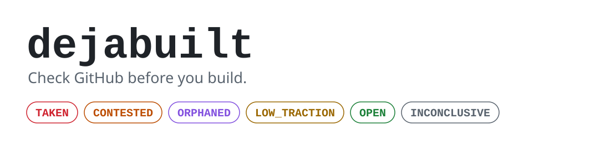

<picture>
  <source media="(prefers-color-scheme: dark)" srcset="docs/assets/banner-dark.svg">
  
</picture>

**Ask your coding agent whether your idea already exists on GitHub, and get an honest answer with the numbers.**

[](https://github.com/maximilianfeix/dejabuilt/actions/workflows/ci.yml)
[](LICENSE)


dejabuilt is an agent skill. Before you start a project, it searches GitHub in
several phrasings, looks closely at the strongest candidates and gives you one
verdict: `TAKEN`, `CONTESTED`, `ORPHANED`, `LOW_TRACTION`, `OPEN` or
`INCONCLUSIVE`.

```
/plugin marketplace add maximilianfeix/dejabuilt
/plugin install dejabuilt@dejabuilt
```

Then ask: *"Does a Windows companion app for coding agents already exist?"*

## What you get

This is a real report, produced on 2026-10-10. The idea looked open: every
project found in a first search described itself as a Mac app.

> # dejabuilt: TAKEN
>
> **Idea:** A Windows companion app that shows what coding agents are doing and lets you approve their requests
>
> **Someone already owns this idea.**
>
> - Louis-CFM/coucou has 4,655 stars and is active.
> - It owns this idea today. Building the same thing means competing with it.
>
> | Repository | Stars | Created | Last push | State | Platforms | Latest release | Why |
> | --- | ---: | --- | --- | --- | --- | --- | --- |
> | [Louis-CFM/coucou](https://github.com/Louis-CFM/coucou) | 4,655 | 2026-09-27 | 2026-10-10 | active | windows, macos, linux, ios | 2026-10-08 | Agent status and approvals; described as a Mac app but ships Windows installers |

The description of that repository says "in your Mac's notch". Its release
assets include `Coucou-Windows-0.3.0-setup.exe`. dejabuilt reads the assets.

The [full report](docs/examples/windows-agent-companion/report.md) also lists six
adjacent projects, every query with its result count, and what was not checked.
The [state file](docs/examples/windows-agent-companion/state.json) and the
[marks](docs/examples/windows-agent-companion/marks.json) behind it are in the
repository.

Two more real runs are in [docs/examples](docs/examples/README.md): a
command-line tool for Markdown slides (`TAKEN`), and dejabuilt run on its own
idea (`OPEN`, with two small attempts found).

## Why a search is not enough

Checking by hand goes wrong in four predictable ways. Each one is something this
skill does differently.

| Mistake | What dejabuilt does |
| --- | --- |
| One search phrase. Projects describe themselves in words you would not choose. | Runs 6 to 10 queries in four shapes and merges the results. |
| Trusting the one-line description. It goes stale. | Reads release assets and README headings to see which platforms a project ships. |
| Reading "many tiny repos" as "nobody has done this". | Gives that its own verdict, `LOW_TRACTION`: several attempts, none took off. |
| Concluding "nothing exists". | Says "nothing found with these queries", lists them, and refuses a verdict when the evidence is incomplete. |

## The verdicts

| Verdict | Rule |
| --- | --- |
| `TAKEN` | A maintained repository with at least 2,000 stars does the same thing. |
| `CONTESTED` | A maintained repository with 200 to 1,999 stars does the same thing. |
| `ORPHANED` | A repository with at least 200 stars did this and is no longer maintained. |
| `LOW_TRACTION` | Three or more attempts, none with 200 stars. |
| `OPEN` | Fewer than three attempts, none with 200 stars. |
| `INCONCLUSIVE` | A query failed or a candidate could not be read, so no absence can be claimed. |

"Maintained" means not archived and pushed within the last 365 days. The
thresholds are heuristics chosen by judgement, not validated against outcomes.
Every report prints the values it used, and `--big-stars` and `--traction-stars`
change them.

A verdict is not advice. `TAKEN` does not mean "do not build it", and `OPEN`
does not mean anyone wants it. Stars measure attention, not quality.

## How it works

The work is split so that each side does what it is good at.

1. **Your agent writes the queries.** Phrasing an idea six different ways is a
   language task.
2. **The script searches and inspects.** It calls the GitHub API, merges results
   by repository, and reads the latest releases and README headings of the top
   candidates.
3. **Your agent judges relevance.** It marks each inspected repository `same`,
   `adjacent` or `unrelated`, with a reason. Whether two projects are the same
   idea is a reading task, so the code never guesses it.
4. **The script decides.** The verdict is computed from the marks by a fixed
   policy. The same input always gives the same verdict, and the agent is told
   not to change it.

The design and the reasons behind it are in [docs/DESIGN.md](docs/DESIGN.md).

## Install

**Claude Code**, as a plugin:

```
/plugin marketplace add maximilianfeix/dejabuilt
/plugin install dejabuilt@dejabuilt
```

**With the [skills CLI](https://skills.sh)**, into the current project (add `-g`
for a global install):

```bash
npx skills add maximilianfeix/dejabuilt
```

**By hand**, for Claude Code or any agent that loads skill folders:

```bash
git clone https://github.com/maximilianfeix/dejabuilt.git
cp -r dejabuilt/skills/dejabuilt ~/.claude/skills/
```

The skill folder is self-contained. It needs Python 3.10 or newer and nothing
else: no packages to install, no API key, no account.

A GitHub token is optional. If `GH_TOKEN` or `GITHUB_TOKEN` is set, or the
[GitHub CLI](https://cli.github.com) is logged in, dejabuilt uses it for higher
rate limits. Without one, GitHub's anonymous limits (10 searches a minute, 60
other requests an hour) are enough for a few checks an hour.

## Use it without an agent

The script is an ordinary command-line tool.

```bash
cd skills/dejabuilt/scripts

python run.py search -q "markdown slides cli" -q "notes to presentation" --out state.json
python run.py inspect --from state.json --top 8
# write marks.json: one mark per inspected repository
python run.py verdict --from state.json --marks marks.json
```

`marks.json` looks like this:

```json
{
  "idea": "A CLI that turns Markdown notes into slide decks",
  "marks": {
    "owner/name": { "mark": "same", "reason": "Markdown to slides, CLI, actively released" },
    "other/repo": { "mark": "adjacent", "reason": "Slides from Markdown, but a web editor" }
  }
}
```

Add `--format json` to `verdict` for machine-readable output. Exit codes: `0`
complete, `2` invalid input, `3` partial or inconclusive, `4` nothing could be
fetched.

## What it sends and reads

- It contacts `api.github.com` and nothing else, with GET requests only.
- It sends your search queries and the names of the repositories it inspects.
  Your idea text and your code never leave your machine through this tool.
- Redirects are refused, so a token cannot be forwarded to another host.
- The token is never printed, logged or written to a file.
- Text from repositories (descriptions, asset names) is stripped of control
  characters and escaped before it is shown. README text is never passed on,
  only the platforms its headings mention. The skill tells the agent to treat
  repository content as data and not to follow instructions found in it.

The same in full is in the [privacy policy](PRIVACY.md). See
[SECURITY.md](SECURITY.md) for how to report a problem.

## Compared with similar tools

Three other projects ask a related question. They are not the same tool.

| | dejabuilt | [who-built-this-before-me](https://github.com/iagochavarry/who-built-this-before-me) | [kitbash](https://github.com/Open-Dev-Society/kitbash) | [dont-reinvent](https://github.com/Emanuelel/dont-reinvent) |
| --- | --- | --- | --- | --- |
| Question | Does this project already exist, and how strong is it? | Has this been built, and should I build, fork or contribute? | Which parts of my idea should I borrow, adapt or write? | Should this feature be free, built or bought? |
| Scope | A whole project | A whole project | Components | One feature |
| Form | Skill and Python script | One prompt file | MCP server (Node.js) | Skill |
| Verdict comes from | Code, fixed policy | The model | The model, following a rubric; repository facts are checked by code | The model |
| Sources | GitHub | GitHub, GitLab, package registries, Product Hunt, Hacker News | GitHub | GitHub, npm, PyPI, paid services |
| Checks licences | No | No | Yes | Yes, and known vulnerabilities |
| Licence | MIT | MIT | GPL-2.0 | MIT |

Where the others are better: who-built-this-before-me looks beyond GitHub,
also searches in several framings, and tells you what to do next. kitbash and
dont-reinvent work at the level of a single component, which is the more common
question while coding, and both check licences; dont-reinvent also checks known
vulnerabilities. dejabuilt does none of that.

What dejabuilt adds: the verdict is computed by tested code rather than written
by the model, platforms are read from release assets, a crowd of weak attempts
gets its own verdict, and incomplete evidence produces `INCONCLUSIVE` instead of
a guess.

This table reflects the three READMEs as read on 2026-10-10.

## Limits

- **GitHub only.** GitLab, Codeberg, package registries, app stores and
  closed-source products are not searched. The report says so every time.
- **One page per query.** Each query looks at its top results by stars (20 by
  default). The report shows how many matches were not looked at.
- **Platform hints are hints.** They show that a platform is shipped or
  mentioned, not that it works.
- **Relevance is a judgement.** A wrong mark gives a wrong verdict. The marks
  and their reasons are in the report so you can check them.
- **Push date is a proxy.** A repository can be pushed to without being
  maintained, and the reverse.

## Development

```bash
python -m venv .venv
.venv/bin/pip install -r requirements-dev.txt    # .venv\Scripts\pip on Windows

ruff check . && ruff format --check . && mypy
pytest
```

The tests do not touch the network. One live test runs with `DEJABUILT_LIVE=1`.
CI runs everything on Linux, Windows and macOS with Python 3.10 and 3.14. See
[CONTRIBUTING.md](CONTRIBUTING.md).

## How it was built

With the help of AI coding tools. Every change went through the test suite, CI
on three operating systems and an independent review before it was merged. The
review log, with the nine problems it found, is in
[pull request #3](https://github.com/maximilianfeix/dejabuilt/pull/3).

## Licence

MIT. See [LICENSE](LICENSE).

dejabuilt is an independent project. It is not affiliated with or endorsed by
GitHub, Anthropic or any project named in this README.
